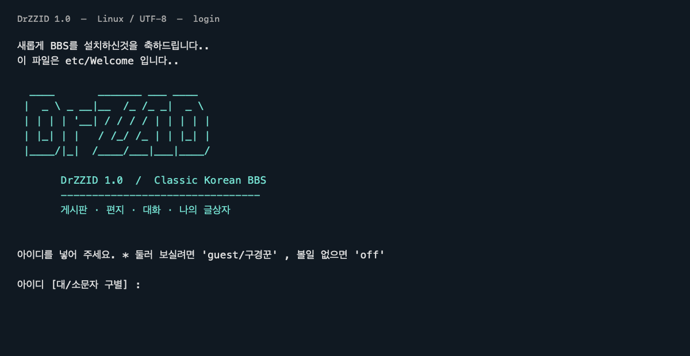

# DrZZID 1.0

말림비(DrZZID)는 터미널에서 사용하는 한국어 BBS(Bulletin Board System)입니다.
연세대학교 YCV에서 수정한 나리 한마당 소스를 바탕으로, 2003년에 사용하던 코드를
현대 Linux 환경에서 빌드하고 실행할 수 있도록 복원한 프로젝트입니다.

한글 입출력을 UTF-8 기반으로 변경하고, K&R 방식의 함수 정의를 정리했습니다.
C17 빌드 설정과 Docker 실행 환경을 제공하며, 원본의 터미널 인터페이스와
게시판·편지·대화 기능을 살펴볼 수 있습니다.

## 화면 미리보기



Docker에서 실행한 로그인 출력을 터미널 스타일로 렌더링한 이미지입니다.
ASCII 로고는 이 문서를 위한 [샘플 배너](docs/examples/issue)이며,
기본 배포 화면은 `root/etc/Welcome`과 `root/etc/issue`의 안내 문구를 사용합니다.
배너 적용 및 화면 재현 방법은 [스크린샷 안내](docs/screenshots/README.md)를 참고하세요.

## 주요 기능

- **게시판**: 글상자를 선택하고 글을 읽거나 작성하며 새 글을 확인합니다.
- **편지**: 사용자 간 편지를 보내고 받은 편지를 읽거나 전달합니다.
- **대화**: 접속 사용자와 대화하고 채팅 기능을 사용할 수 있습니다.
- **개인 글상자**: Mybox의 내용을 확인하고 편집합니다.
- **사용자·운영 관리**: 사용자 정보와 암호를 관리하며, 권한에 따라 운영 메뉴를 사용합니다.

메뉴는 텍스트와 키보드 입력을 중심으로 동작합니다. 표시되는 기능은 계정 권한과
컴파일 설정에 따라 달라질 수 있습니다.

## 빌드 및 실행

Linux(Ubuntu / Debian)에서 필요한 개발 패키지를 설치한 뒤 빌드합니다.

```sh
sudo apt-get update
sudo apt-get install --no-install-recommends build-essential libncurses-dev libcrypt-dev
make
make test
```

`make`는 `src/`에 BBS와 보조 실행 파일을 생성합니다. `make test`는 빌드 후
모든 C 소스에 엄격한 선언·타입 검사를 적용하는 구문 검사를 실행합니다.
실제 실행에는 별도의 데이터 디렉터리와 계정 초기화가 필요합니다.
[설치·실행 안내](docs/INSTALL.md)에 따라 `root/` 템플릿을 복사하고 `BBSHOME`을 설정하세요.

macOS에서는 Docker로 Linux 실행 환경을 사용할 수 있습니다.

```sh
make docker-build
docker run --rm -it --entrypoint sh drzzid:legacy
```

컨테이너 내 테스트 계정 생성과 실행 절차도 [설치·실행 안내](docs/INSTALL.md)에 있습니다.
이 복원판은 원본의 외부 명령 실행과 레거시 암호 방식을 포함하므로,
격리된 복원·개발 환경에서 사용하세요.

## 저장소 구성

| 경로 | 내용 |
| --- | --- |
| `src/` | BBS 코어, 채팅 데몬, 계정 생성 등 C 소스와 빌드 설정 |
| `root/` | 실행 데이터 디렉터리의 초기 템플릿과 안내 문구 |
| `docs/` | 설치 방법, 원본 프로젝트 소개, 화면 예시 |
| `Dockerfile` | Debian 기반 빌드·실행 환경 |

[원본 프로젝트 소개](docs/README) · [설치·실행](docs/INSTALL.md) · [라이선스](LICENSE.md)

라이선스: GPL-2.0-only. 원문은 [COPYING](COPYING)을 참고하세요.
